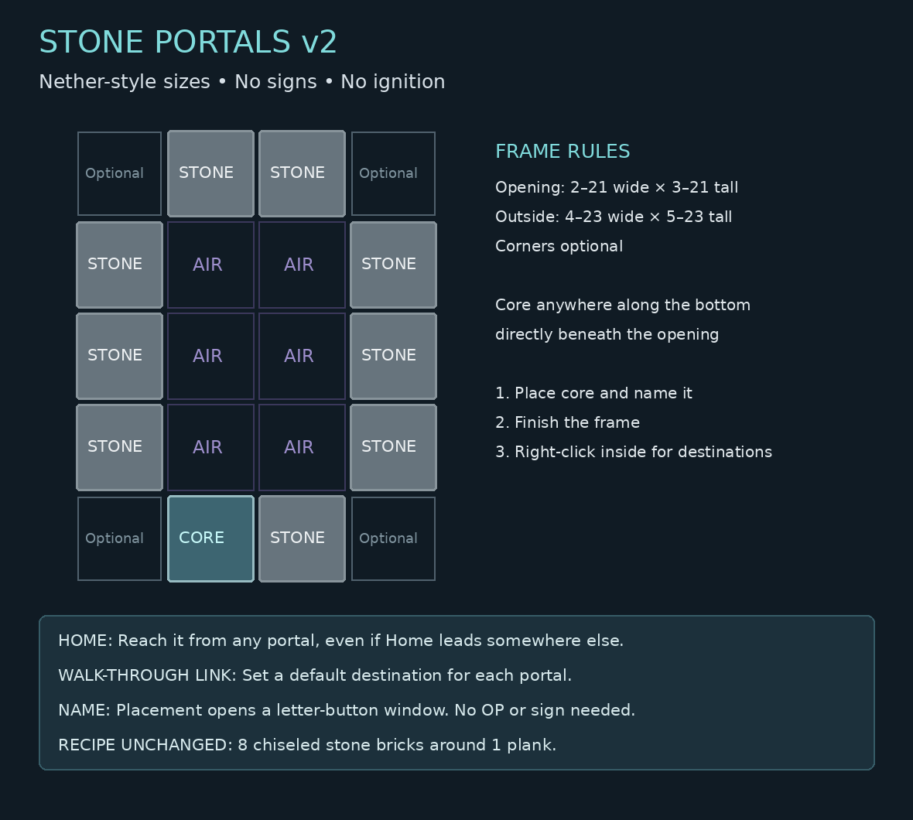
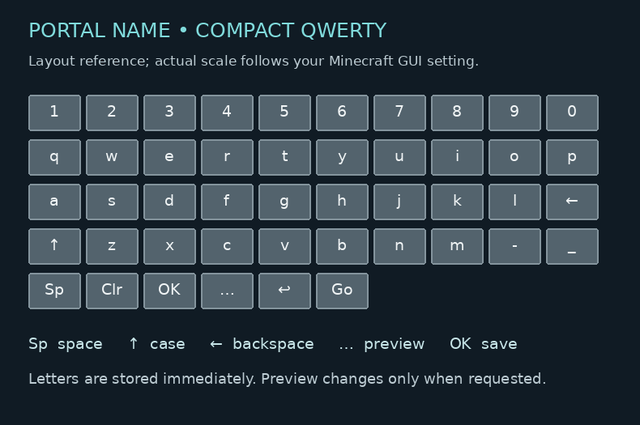

# Minecraft Teleporter

Wolfie Linked Stone Portals **v2.2** for **Minecraft Java Edition 26.3**. A server-side datapack for vanilla clients, with named stone portals, a destination picker, and a shared Home portal.

## Download and install

1. Download [wolfie_linked_portals_v2.2_mc26.3.zip](downloads/wolfie_linked_portals_v2.2_mc26.3.zip?raw=true).
2. Put the ZIP, still zipped, in your world's `datapacks` folder.
3. Remove older copies of this pack, then run `/reload` or restart the server.

When updating, keep your world data and **do not run the uninstall function**. Core names, owners, routes, and Home are stored in the world.

## Craft and build

Craft a Portal Core using **eight chiseled stone bricks surrounding one wooden plank**. A regular lodestone plus a plank reattunes a mined core.

Build a vertical stone frame with a **2–21 block wide, 3–21 block high empty opening**. Corners are optional. Place one crafted core anywhere along the bottom, directly beneath the opening. Stone, cobblestone, stone bricks, deepslate and the supported full-block variants can be mixed. No sign, resource pack, client mod, or ignition is required.



## Name and travel

Placing a core opens a compact QWERTY naming window. Click letters, use **…** to preview, and **OK** to save. The preview is manual to avoid repeatedly rebuilding the window.

**Right-click a completed portal → Destinations → choose a named portal.** The destination page has six entries per page, navigation, and a Home shortcut. The keyboard's **Go** button also opens Destinations.

**Settings → Walk-through link** configures the portal's default outgoing route. Routes are one-way. Step fully out after arrival before walking into another portal.

The core owner can designate the shared **Home**. Every portal can return to Home regardless of Home's own outgoing route. Unlinked portals fall back to Home when one exists. An operator can run `/function wolfie_portals:clear_home` before assigning a replacement Home.



## Useful commands

Give one core to yourself:

```mcfunction
/function wolfie_portals:give_core
```

Give one to an online player from the server console:

```mcfunction
execute as PlayerName run function wolfie_portals:give_core
```

To hide the vanilla `Triggered [wp.ui]…` messages, an operator may run:

```mcfunction
/gamerule send_command_feedback false
```

This also hides normal command-success feedback server-wide; the pack does not change that rule automatically.

If a menu causes a client FPS drop, compare with **Menu Background Blur** set to zero in Accessibility Settings. Client-side rendering still needs in-game testing.

## Documentation and validation

See [README.txt](README.txt) for supported blocks, ownership, updates, troubleshooting and removal, and [VALIDATION.txt](VALIDATION.txt) for the dedicated-server checks and their limits. Tests covered portal geometry, naming callbacks, destination paging, ownership, Home, and unloaded cross-dimension travel. A graphical Minecraft client was not run during those checks.

The repository root contains the unpacked datapack. The exact installable archive is in [downloads](downloads/).
